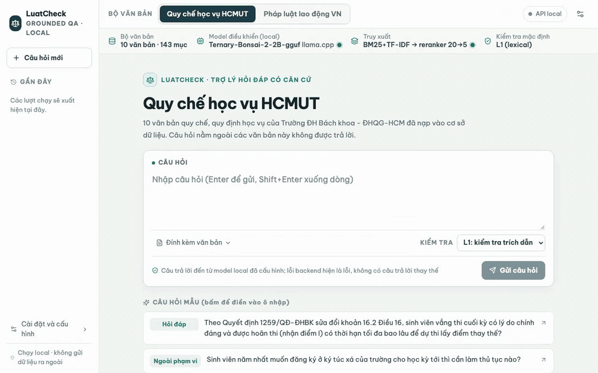
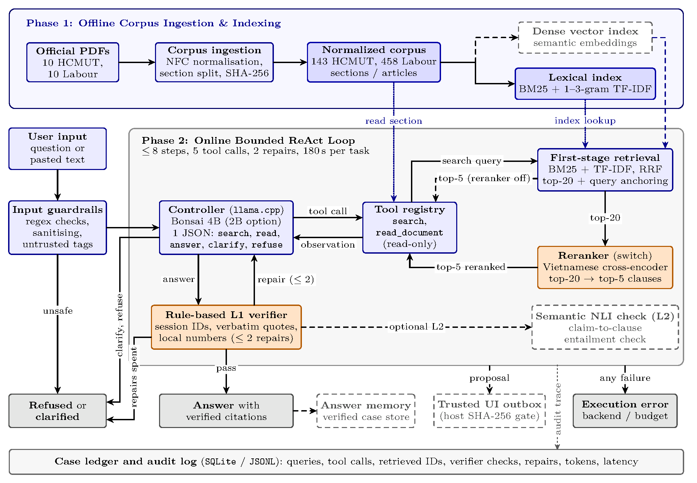
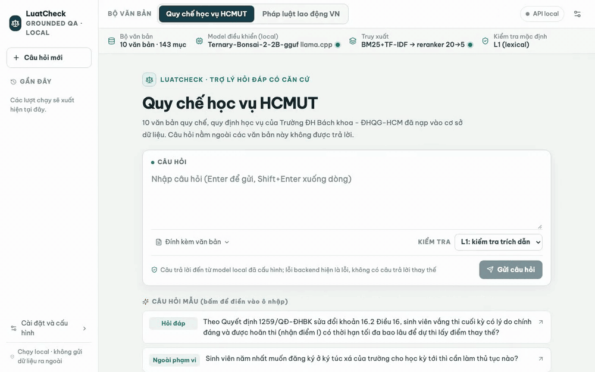

# LuatCheck

**A small, local assistant that answers only from a document collection, cites the sections it used, checks those citations in code, and refuses or asks a question when the sources do not answer.**

<p align="center">
  
</p>

CO5151 Advanced Agentic Artificial Intelligence, Group 8, Ho Chi Minh City University of Technology (HCMUT).
Two document collections are implemented and evaluated: HCMUT academic regulations and Vietnamese labour-law texts.

## Demo

| Labour law: answer with a verified citation | The verifier rejects drafts and asks for repairs |
|---|---|
|  |  |

The recordings above (including the HCMUT one at the top) use the current system with the 2B controller (faster), 25 Oct 2026; the 4B controller gives more accurate answers but takes about 30 s per question.
Each answer shows the cited section (click to expand the source text with the quoted span highlighted) and the agent's
timeline: search, reranking, reading, the citation check and any repair. The right-hand clip is a real failure case: the verifier
rejected the draft's quote, two repairs did not fix it, and the run ended as a refusal rather than an unsupported answer.
Recordings with the 4B controller (the live-demo configuration) are in `deliverables/d2/demo/gifs/`: `11_hcmut_answer_4b.gif`, `12_labour_answer_4b.gif`,
`13_verifier_repair_4b.gif` (repair, then a verified answer) and the backup video `demo_backup_4b.mp4`.

## What it does

- **Grounded answers with citations:** the agent searches and reads the corpus, then answers with the section ids it used; the UI opens each cited section with the quoted sentence highlighted.
- **Checks its own citations (L1):** a lexical verifier checks ids, retrieval provenance, quote overlap and exact quantities, and sends the model back to repair a failed answer (at most 2 repairs). These are proxies, not proof of correctness.
- **Refuses and clarifies:** when the sources do not cover a question the model refuses or asks which case is meant; an unsafe input is blocked before any model call.
- **Runs on a laptop:** a 2B or 4B ternary controller (Ternary Bonsai, GGUF) on llama.cpp plus a Vietnamese cross-encoder reranker, all on one Mac.
- **Honest failures:** a backend or budget failure is an execution error, never a substitute answer; there are no mock models anywhere, including in tests.
- **Replayable evaluation:** two frozen, hash-locked 50-task benchmarks, a one-command runner and per-run artifacts (see "Reproducing the numbers").

## Architecture



- **Loop:** a bounded ReAct loop (at most 8 steps, 5 tool calls, 2 repairs, 180 s per task); the controller emits one JSON action per step: `search`, `read`, `answer`, `clarify` or `refuse`.
- **Retrieval and reranker:** first-stage BM25 + TF-IDF with reciprocal rank fusion; in the L1+rerank variant the top 20 are re-scored by a Vietnamese cross-encoder (AITeamVN/Vietnamese_Reranker, GGUF f16) and the top 5 are returned.
- **L1 verifier and repair:** an `answer` is accepted only if its citations pass L1; otherwise the verifier's feedback goes back to the controller, and after the repairs are spent the run ends as a refusal.
- **Guardrails:** pattern checks, sanitising and untrusted-input tagging run before the model; the tool layer is read-only and writes need a trusted-UI approval.
- **On-device controller:** Ternary Bonsai 2B or 4B (PrismML llama.cpp fork, Metal) with decoding constrained to the action JSON schema.

The drawing is the report's Figure 1 (source `docs/images/architecture.tex`); module map and data flow: [docs/architecture.md](docs/architecture.md).

## Chosen D2 system

**LuatCheck r2** with **Ternary Bonsai 4B** (or **2B**) as controller, **L1** verification and the **reranker**: the profiles `config/profiles/demo-hcmut.yaml` and `demo-labour.yaml` (and `-2b` variants). Print what a profile switches on, without loading a model:

```sh
.venv/bin/python -m src.pipeline config/profiles/demo-hcmut.yaml
```

r2 is a post-hoc revision of the first frozen system (v3): it was designed after the v3 results on the same tasks were seen. Details: [docs/plans/D2_REVISION_L1_BONSAI4B.md](docs/plans/D2_REVISION_L1_BONSAI4B.md).

## Results at a glance

Strict success (%) of the full system (variant L1+rerank), mean over 3 seeds, 50 tasks per benchmark, with the bootstrap interval; source: [evaluation/comparisons/v3-2B_vs_r2-2B_vs_r2-4B/comparison.md](evaluation/comparisons/v3-2B_vs_r2-2B_vs_r2-4B/comparison.md).

| benchmark | v3-2B | r2-2B | r2-4B |
|---|---|---|---|
| hcmut_v1 | 14.0 [8-21] | 28.7 [20-37] | 60.7 [50-71] |
| labour_vi_v1 | 18.7 [11-27] | 28.0 [19-37] | 56.7 [47-67] |

Caveats: strict success is an **LLM-judge estimate** (lower bound; errors count as failures), not human labels. r2 was designed after seeing v3 on the same tasks, so the v3 to r2 gap is a post-hoc improvement, not a pre-planned result. The comparison file also has behaviour match, Recall@5, answer rate and error rate.

## Demo quickstart (Mac, 16 GiB)

```sh
.venv/bin/pip install -r requirements.txt
make prism-setup                # once: build the llama.cpp fork, download the 2B GGUF
make demo-model-server          # terminal 1: controller, Bonsai 4B, 127.0.0.1:8081 (first start downloads the 4B GGUF)
make rerank-server-mac          # terminal 2: reranker, 127.0.0.1:8082
make demo-web                   # terminal 3: UI on http://127.0.0.1:8000, HCMUT / labour corpus switch
```

Lighter Bonsai 2B demo, side by side with the above: `make demo-model-server-2b` (port 8083), then `make demo-web-2b` (UI on port 8001); it uses the same reranker server. If a server is down a run ends as an execution error by design. Demo queries, timings and fallbacks: [deliverables/d2/demo/DEMO_SCRIPT.md](deliverables/d2/demo/DEMO_SCRIPT.md).

<details>
<summary>Safety behaviour: refusal when the sources do not answer, and an injection blocked before the model</summary>

| Out-of-scope question refused | Prompt-injection attempt blocked by the guardrail |
|---|---|
|  |  |

These two were recorded on 24 Oct 2026 with the 2B controller of the initial system; the same two scenarios recorded with the 4B controller on 25 Oct are `14_hcmut_refuse_4b.gif` and `15_guardrail_4b.gif` in `deliverables/d2/demo/gifs/`.

</details>

More recordings (clarification, verifier off, reranker down) are in `deliverables/d2/demo/gifs/`.

From Python:

```python
from src.agent.loop import LuatCheckAgent

agent = LuatCheckAgent.from_config("config/profiles/demo-hcmut.yaml")   # needs the two servers above
ledger = agent.run("Khi tham gia sự kiện của Nhà trường, người học phải có mặt trước giờ khai mạc ít nhất bao lâu?")
print(ledger.terminal_status, ledger.final_output)    # answered | clarified | refused | error
```

## Reproducing the numbers

Every reported number comes from `evaluation/run_d2.py` runs (resumable, with preflight checks of benchmark locks, model files and servers); run directories are indexed in `evaluation/runs/REGISTRY.md`. Step-by-step commands: [docs/REPRODUCE_D2.md](docs/REPRODUCE_D2.md); machine setup and the run matrix: [docs/RUNBOOK_D2.md](docs/RUNBOOK_D2.md); metric definitions and their limits: [docs/BENCHMARKS_AND_METRICS.md](docs/BENCHMARKS_AND_METRICS.md). Judge scores stay LLM estimates until checked against the team's human audit ([guide](docs/HUMAN_AUDIT_GUIDE.md)).

## Repository map

| Path | Content |
|---|---|
| `src/agent`, `src/tools`, `src/retrieval`, `src/verifier`, `src/security` | loop, tool registry, retrieval and reranker, L1 verifier, guardrails |
| `src/pipeline`, `src/api`, `frontend/` | config-to-components builder, FastAPI backend, React demo UI |
| `config/` | profiles (`config/profiles`), per-domain settings (`config/domains`), benchmark matrix (`config/benchmark`) |
| `data/corpus/` | source-backed corpora: `hcmut_academic_v1.json`, `labour_vi_v1.json` |
| `evaluation/` | benchmark runner, `benchmarks/` (frozen tasks), `runs/` (replayable run artifacts), `comparisons/` |
| `deliverables/d2/report/` | D2 interim report (LaTeX, PDF), provenance of every table |
| `docs/` | runbook, reproduction guide, reviews, plans, demo script and GIFs |
| `tests/` | tests of the real implementations (no mocks, no monkeypatching) |

Development: `.venv/bin/python -m pytest tests/ -q` (includes real inference: do not run it during benchmark collection). Integrity rules: [AGENTS.md](AGENTS.md).

## Documentation

- Report: [deliverables/d2/report/main_d2.pdf](deliverables/d2/report/main_d2.pdf), source [main_d2.tex](deliverables/d2/report/main_d2.tex), [requirements](deliverables/d2/report/D2_REQUIREMENTS.md), [table provenance](deliverables/d2/report/RESULTS_PROVENANCE.md)
- Slides: [outline](deliverables/d2/demo/D2_SLIDES_OUTLINE.md), [demo script](deliverables/d2/demo/DEMO_SCRIPT.md)
- Reviews: [benchmark quality](docs/reviews/benchmark_quality_2026-10-23.md), [metrics](docs/reviews/metrics_review_2026-10-23.md), [v3 failure analysis](docs/reviews/v3_failure_analysis_2026-10-24.md), [requirements gap](docs/reviews/d2_requirements_gap_2026-10-23.md)
- Plans: [completion plan](docs/plans/D2_COMPLETION_PLAN.md), [reranker](docs/plans/reranker.md), [benchmarking](docs/plans/benchmarking.md)
- Configuration: [config/README.md](config/README.md), [web UI API](docs/web-ui-api.md)
- Historical, not current evidence: the earlier Qwen2.5-3B pilot on `bll2019_v1`, [redteam/](redteam/README.md), [deliverables/d3/report/](deliverables/d3/report/README.md)

## Course and team

CO5151 Advanced Agentic Artificial Intelligence, Application Track, Group 8. Instructor: TS. Lê Xuân Bách. Members: Lê Trí Quyền, Võ Phạm Tuấn Dũng, Nguyễn Hoàng Phong. Repository: https://github.com/tuandung222/LuatCheck-D2
