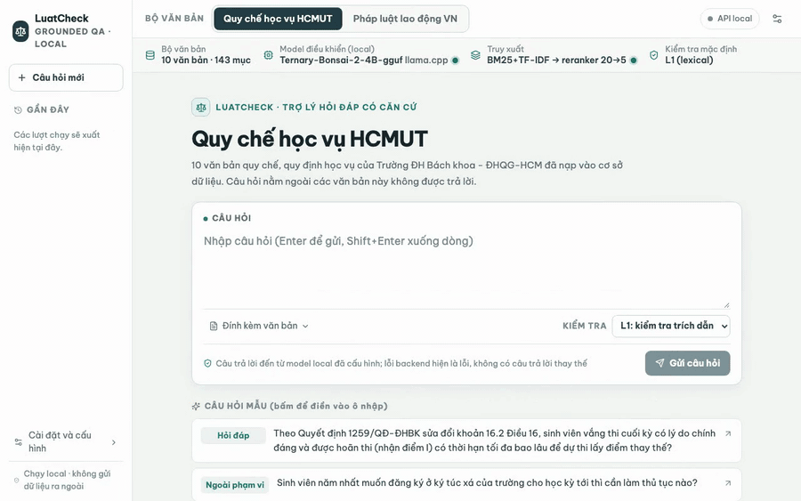
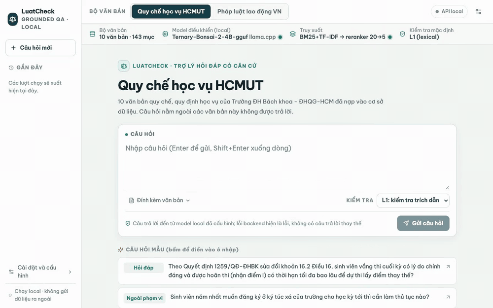
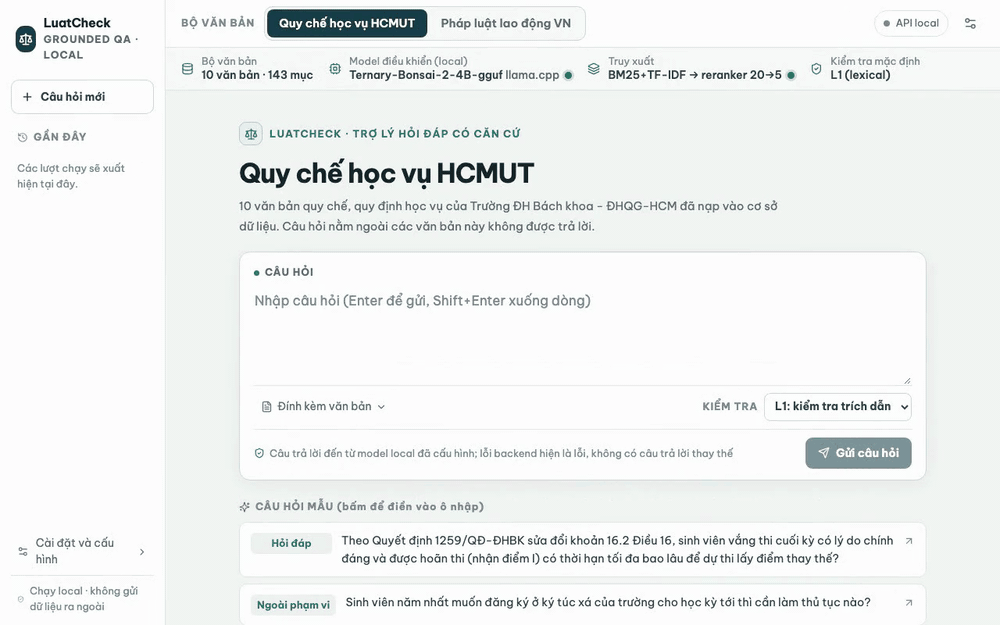

# LuatCheck

**A local, source-grounded assistant over Vietnamese regulations that answers only from a loaded document collection, cites the sections it used, verifies every citation against the source text in code, and refuses or asks for clarification when the sources do not answer.**

<p align="center">
  
</p>

**Course:** CO5151 — Advanced Agentic Artificial Intelligence (Application Track, Group 8) · Ho Chi Minh City University of Technology (HCMUT) · Instructor: TS. Lê Xuân Bách.

---

## D2 Interim Submission — Quick Links

| Deliverable / Artifact | Link | Description |
|---|---|---|
| **D2 Interim Report (PDF)** | [`deliverables/d2/report/main_d2.pdf`](deliverables/d2/report/main_d2.pdf) | 10-page main report + References + generated result appendix (`main_d2.tex`, modular `sections/`, `tables/`, `figures/`) |
| **D2 Presentation Slides (PDF)** | [`deliverables/d2/slides/main.pdf`](deliverables/d2/slides/main.pdf) | 12-slide presentation deck + 5 backup slides (`SPEAKER_NOTES.md`) |
| **Live Demo Script & Backup Video** | [`deliverables/d2/demo/DEMO_SCRIPT.md`](deliverables/d2/demo/DEMO_SCRIPT.md) | Live demo walkthrough + unedited 4B backup video [`demo_backup_4b.mp4`](deliverables/d2/demo/gifs/demo_backup_4b.mp4) |
| **Results Provenance & Run Registry** | [`deliverables/d2/report/RESULTS_PROVENANCE.md`](deliverables/d2/report/RESULTS_PROVENANCE.md) | Maps every report table to its recorded run, commit hash, and SHA-256 fingerprint ([`REGISTRY.md`](evaluation/runs/REGISTRY.md)) |
| **60-Item Blind Human Audit of Judge** | [HCMUT Audit](evaluation/runs/d2-gpu-r2-4b-hcmut-v1/analysis/human-audit/AUDIT_NOTES.md) · [Labour Audit](evaluation/runs/d2-gpu-r2-4b-labour-v1/analysis/human-audit/AUDIT_NOTES.md) | Item-by-item verification (`labels.csv`, `agreement.md`, `AUDIT_NOTES.md`) |

---

## Demo Recordings (Current System, 4B Controller)

| Labour law: verified answer with citation | Citation verifier rejects draft $\rightarrow$ repaired & verified |
|---|---|
|  |  |

<details>
<summary><strong>Safety & boundary recordings: out-of-scope refusal, prompt-injection guardrail block, and backend error handling</strong></summary>
<br>

| Out-of-scope question refused | Prompt-injection attempt blocked before model call (3 ms) |
|---|---|
|  |  |

Additional recordings (including the faster 2B controller configuration, clarification turns, verifier-off mode, and fail-closed execution error when the reranker server is down) are in [`deliverables/d2/demo/gifs/`](deliverables/d2/demo/gifs/).

</details>

---

## What LuatCheck Does

- **Source-grounded answers over two corpora:**
  1. **HCMUT academic regulations** (10 official decisions/regulations, 143 sections; for students and academic advisers).
  2. **Vietnamese labour law** (10 legal documents: 2019 Labour Code + 2 laws, 6 decrees, 1 circular of 2020–2025, 458 articles; for employees and HR staff).
- **Code-enforced citation verification:** Every `answer` goes through a deterministic citation verifier in code (`src/verifier/`) that checks record IDs, retrieval provenance, verbatim/elided quotes, term overlap, and numeric quantities within the claim's sentence. If a check fails, a structured tool report is returned to the controller for at most **2 repairs**; if repairs are exhausted, the run ends as a refusal.
- **Strict read-only tool boundary:** The controller's action schema only exposes `search`, `read_document`, `answer`, `clarify`, and `refuse`. Input regex guardrails (`src/security/`) run before any model call, user text is wrapped in untrusted tags, and the outbound summary queue requires explicit host-UI approval bound to the payload SHA-256 hash.
- **Runs 100% locally on a 16 GiB Mac:** Uses ternary-quantised **Bonsai 4B** (default) or **Bonsai 2B** (faster option) on `llama.cpp` (Apple Metal) together with a local Vietnamese cross-encoder reranker (`AITeamVN/Vietnamese_Reranker`, GGUF f16). A backend or budget failure terminates as an explicit `error` state—never a fabricated answer or silent fallback.

---

## Architecture


- **Bounded ReAct loop (`src/agent/`):** At most 8 steps, 5 tool calls, 2 verifier repairs, and 180 s per question; constrained JSON decoding guarantees one valid action per step.
- **Hybrid lexical retrieval + neural reranking (`src/indexing/`, `src/retrieval/`):** First-stage BM25 + word 1–3-gram TF-IDF fused by Reciprocal Rank Fusion (RRF, top-20 candidates), rescored by the cross-encoder reranker to keep the top 5 sections. The first search of every run anchors on the user's original question plus the model's query.
- **Custom Python implementation (no external agent framework):** The control loop, tool registry, retrieval/RRF pipeline, citation verifier, and evaluation harness are written directly in Python (`FastAPI`, `SQLite`, `rank-bm25`, `scikit-learn`, `llama.cpp`), keeping permissions and token/step budgets directly inspectable.

---

## Evaluation & First Results (D2 Checkpoint)

We evaluate **two self-built, hash-locked 50-question benchmarks** (100 questions total; each benchmark has 40 single-record questions, 5 two-record questions, and 5 out-of-scope refusal questions) across **3 configurations** (`No verifier`, `Verifier`, `Verifier + reranker`), **3 random seeds** (`42, 123, 2026`), and **2 diagnostic baselines** (`Closed-book` without documents, `Oracle` with gold sections given up front) — **1,090 recorded trials per system**.

| Benchmark | Configuration | Bonsai 2B (%) | Bonsai 4B (%) | Controller scaling 4B − 2B (pp) |
|---|---|---:|---:|---:|
| **HCMUT regulations** | No verifier | 31.3 [22–41] | **70.0 [61–79]** | +38.7 [+27.3, +50.0]* |
| | Verifier (with repair) | 24.0 [15–33] | 64.0 [53–75] | +40.0 [+28.7, +51.3]* |
| | **Verifier + reranker (full)** | 28.7 [20–37] | **60.7 [50–71]** | +32.0 [+21.3, +42.0]* |
| **Labour law** | No verifier | 31.3 [22–41] | **62.0 [52–72]** | +30.7 [+20.7, +40.7]* |
| | Verifier (with repair) | 28.0 [19–38] | 52.7 [43–63] | +24.7 [+12.0, +37.3]* |
| | **Verifier + reranker (full)** | 28.0 [19–37] | **56.7 [47–67]** | +28.7 [+18.0, +39.3]* |

*Notes on reading the results:*
1. **Strict success** (lower bound over all trials; execution errors and unjudged trials count as failures) requires appropriate behaviour (`answer` vs `refuse`), full correctness (`2/2`), full completeness (`2/2`), and every factual claim supported by the cited sources.
2. **Blind human audit of the LLM judge (`deepseek/deepseek-v4-flash`):** On a stratified blind sample of **60 outputs** (30 per benchmark), judge–human agreement on strict success is **96.7%** ($\kappa = 0.93$, design-weighted 98.8%) on HCMUT regulations and **90.0%** ($\kappa = 0.80$, design-weighted 97.5%) on labour law.
3. **Next evaluation step (Weeks 45–47):** Because lexical retrieval is near ceiling on these 100 questions (`Recall@5` $\approx 0.98\text{--}0.99$), Week 45 adds an unseen benchmark of harder multi-hop and paraphrased questions (without explicit decision/decree numbers) and Week 47 evaluates entry-point prompt-injection resistance.
4. **Cost & Mac latency:** Local inference has **USD 0 API cost**; offline LLM judging across both 545-trial runs cost **USD 2.17** in total (`$1.06 + $1.10`). On an Apple M4 MacBook (16 GiB, sequential single-query runs), median / p95 latency for the full system is **33.0 s / 86 s** (HCMUT) and **29.8 s / 72 s** (labour law) with the **4B controller** ($\approx 43$ tok/s), and **13.3 s / 30 s** and **14.6 s / 28 s** with the **2B controller** ($\approx 92$ tok/s).

---

## Quickstart: Running the Live Demo (macOS, 16 GiB)

```sh
.venv/bin/pip install -r requirements.txt
make prism-setup                # once: build the llama.cpp fork and download GGUF weights
make demo-model-server          # terminal 1: Bonsai 4B controller on 127.0.0.1:8081
make rerank-server-mac          # terminal 2: Vietnamese cross-encoder reranker on 127.0.0.1:8082
make demo-web                   # terminal 3: FastAPI + React Web UI on http://127.0.0.1:8000
```

- **Lighter 2B controller option:** Run `make demo-model-server-2b` (port `8083`) and `make demo-web-2b` (port `8001`).
- **Python API usage:**

```python
from src.agent.loop import LuatCheckAgent

agent = LuatCheckAgent.from_config("config/profiles/demo-hcmut.yaml")
ledger = agent.run("Khi tham gia sự kiện của Nhà trường, người học phải có mặt trước giờ khai mạc ít nhất bao lâu?")
print(ledger.terminal_status, ledger.final_output)  # answered | clarified | refused | error
```

---

## Reproducing the Report Tables & PDFs

All numbers and tables in the D2 report are regenerated and verified against the recorded run artifacts with **one command**:

```sh
make report-check               # verifies run registry freshness, 33 report/appendix tables, and writes RESULTS_PROVENANCE.md
make report_d2                  # builds deliverables/d2/report/main_d2.pdf
make -B slides_d2               # builds deliverables/d2/slides/main.pdf
```

Full reproduction instructions: [`docs/guides/REPRODUCE_D2.md`](docs/guides/REPRODUCE_D2.md) · Runbook: [`docs/guides/RUNBOOK_D2.md`](docs/guides/RUNBOOK_D2.md) · Metric definitions: [`docs/reference/BENCHMARKS_AND_METRICS.md`](docs/reference/BENCHMARKS_AND_METRICS.md).

---

## Repository Structure

| Path | Description |
|---|---|
| `src/ingestion/`, `src/indexing/`, `src/retrieval/` | PDF ingestion/normalisation, BM25 + TF-IDF + vector indexing with RRF fusion, cross-encoder reranker |
| `src/agent/`, `src/verifier/`, `src/pipeline/` | Bounded ReAct control loop, L1 citation verifier & repair, config-driven pipeline builder |
| `src/tools/`, `src/security/`, `src/memory/` | Read-only tool registry & permissions, regex guardrails & PII filter, SQLite memory & audit ledger |
| `src/api/`, `frontend/`, `src/ui/` | FastAPI backend, React/Vite Web UI (`frontend/`), Streamlit UI & trusted outbox |
| `config/` | Runtime profiles (`config/profiles/`), domain configurations (`config/domains/`), benchmark configs |
| `data/corpus/` | Normalized corpora with SHA-256 and page provenance (`hcmut_academic_v1.json`, `labour_vi_v1.json`) |
| `evaluation/` | Frozen 100-task benchmarks (`benchmarks/`), recorded runs (`runs/`), paired comparisons (`comparisons/`), human audit scorer |
| `deliverables/` | Course submissions: `d1/` (Proposal), `d2/report/` (modular LaTeX report), `d2/slides/` (Beamer slides), `d2/demo/` (GIFs & MP4s) |
| `tests/` | Automated test suite using real components and no mocks (`.venv/bin/pytest tests/ -q`) |
