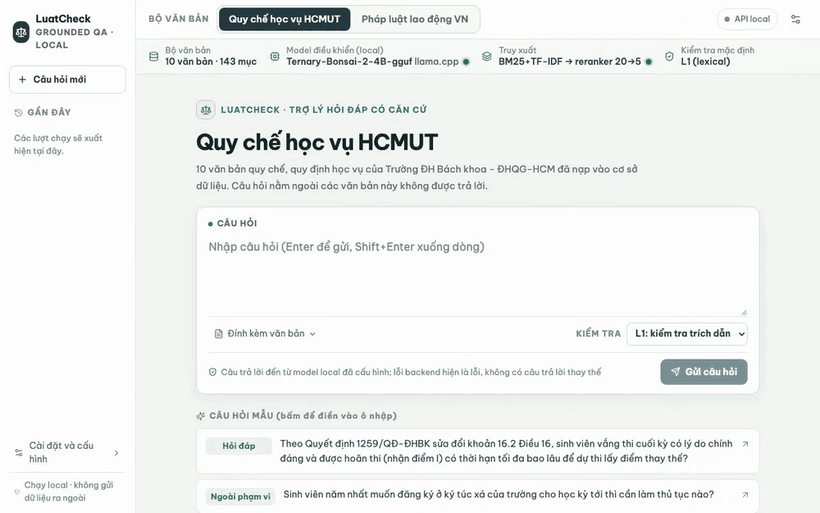
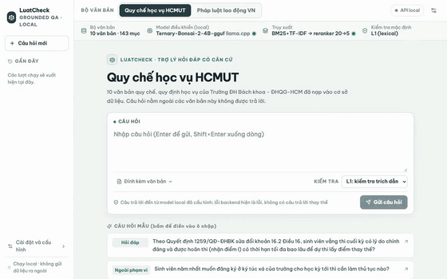
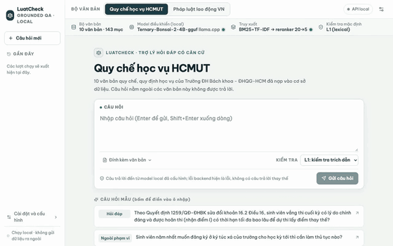

# LuatCheck

**A local, source-grounded assistant over Vietnamese regulations that answers only from a loaded document collection, cites the sections it used, verifies every citation against the source text in code, and refuses or asks for clarification when the sources do not answer.**

<p align="center">
  
</p>

<details>
<summary><strong>More demo recordings (Bonsai 4B controller): labour-law QA, verifier repair, out-of-scope refusal & guardrail block</strong></summary>
<br>

| Labour law: verified answer with citation | Citation verifier rejects draft $\rightarrow$ repaired & verified |
|---|---|
|  |  |

| Out-of-scope question refused | Prompt-injection attempt blocked before model call (3 ms) |
|---|---|
|  |  |

</details>

---

## What LuatCheck Does

- **Source-grounded answers over two corpora:**
  1. **HCMUT academic regulations** (10 official decisions/regulations, 143 sections; for students and academic advisers).
  2. **Vietnamese labour law** (10 legal documents: 2019 Labour Code + 2 laws, 6 decrees, 1 circular of 2020–2025, 458 articles; for employees and HR staff).
- **Rule-based L1 citation verifier (`src/verifier/lexical_grounding_v2.py` — deterministic Python heuristic, NOT an LLM, neural model, or second agent):** Every proposed `answer` runs through a $<2\text{ ms}$ rule-based gate with **3 hard checks** and **1 soft diagnostic check** (full specification in [`docs/reference/CITATION_VERIFIER_L1.md`](docs/reference/CITATION_VERIFIER_L1.md)):
  1. *Session retrieval provenance (hard gate):* every cited `article_id` must exist in the corpus and have been returned by `search` or `read_document` in the current run.
  2. *Normalised verbatim / elided quote match (hard gate):* after Unicode NFC, case, and whitespace/line-wrap folding, every non-trivial segment ($\ge 12$ chars or $\ge 3$ words) of a quote (supporting `...` elisions) must appear verbatim and in order inside the cited section, with digit-boundary guards (`5` cannot match inside `15` or `3,5`).
  3. *Claim-local numeric & unit verification (hard gate):* every number + unit in an answer sentence must occur inside the $\le 300$-character source window that best matches the surrounding $\pm 8$ context words of that claim.
  4. *Content-token overlap (soft warning, threshold $\ge 0.50$):* logs a diagnostic warning if fewer than $50\%$ of a sentence's non-stopword tokens appear in the best source window.
  If any hard gate fails, a structured tool report with the closest 170-character source passage is returned to the controller for at most **2 repairs**; if repairs are exhausted, the run terminates as a refusal.
- **Strict read-only tool boundary:** The controller's action schema only exposes `search`, `read_document`, `answer`, `clarify`, and `refuse`. Input regex guardrails (`src/security/`) run before any model call, user text is wrapped in untrusted tags, and the outbound summary queue requires explicit host-UI approval bound to the payload SHA-256 hash.
- **Runs 100% locally on a 16 GiB Mac:** Uses ternary-quantised **Bonsai 4B** (default) or **Bonsai 2B** (faster option) on `llama.cpp` (Apple Metal) together with a local Vietnamese cross-encoder reranker (`AITeamVN/Vietnamese_Reranker`, GGUF f16). A backend or budget failure terminates as an explicit `error` state—never a fabricated answer or silent fallback.

---

## Architecture


- **Phase 1 — Offline ingestion & indexing (`src/ingestion/`, `src/indexing/`):** Extracts official PDFs, normalises text to Unicode NFC, segments records at article/clause boundaries with SHA-256 and page provenance (`data/corpus/*.json`), and builds persisted hybrid indexes (`SQLite FTS5` + `google/embeddinggemma-2` `768-d` / `128-d` vectors across `NumPy`, `FAISS`, `HNSW`, and `Qdrant`) alongside the in-memory `BM25 + TF-IDF` baseline.
- **Phase 2 — Online bounded ReAct loop (`src/agent/`):** At most 8 steps, 5 tool calls, 2 verifier repairs, and 180 s per question; constrained JSON decoding guarantees one valid action (`search`, `read`, `answer`, `clarify`, `refuse`) per step.
- **Hybrid retrieval (Weighted RRF) + neural reranking (`src/retrieval/`, `src/indexing/hybrid.py`):** First-stage retrieval defaults to **Weighted RRF (`0.75 * SQLite FTS5 + 0.25 * EmbeddingGemma-2 768-d`)** (with live UI switching between `Weighted RRF 768-d`, `BM25 + TF-IDF`, `SQLite FTS5`, `Vector 768-d`, and `Standard RRF 50/50`), retrieving top-20 candidates rescored by the cross-encoder reranker to keep the top 5 sections. The first search of every run anchors on the user's original question plus the model's query.
- **Custom Python implementation (no external agent framework):** The control loop, tool registry, retrieval/RRF pipeline, citation verifier, and evaluation harness are written directly in Python (`FastAPI`, `SQLite`, `rank-bm25`, `scikit-learn`, `llama.cpp`), keeping permissions and token/step budgets directly inspectable.

---

## Evaluation & Benchmark Results

> **Evaluation Scope:** The current evaluation suite primarily validates that the end-to-end agentic pipeline and automated measurement harness run reliably and produce reproducible, auditable measurements across configurations. Further system improvements and broader empirical experiments—including harder unseen multi-hop/paraphrased benchmarks where lexical retrieval is not near ceiling, reducing verifier repair-budget over-refusals, dense embedding retrieval, and red-team prompt-injection evaluations—are part of ongoing development.

We evaluate **two self-built, hash-locked 50-question benchmarks** (100 questions total; each benchmark has 40 single-record questions, 5 two-record questions, and 5 out-of-scope refusal questions) across **3 configurations** (`No verifier`, `Verifier`, `Verifier + reranker`), **3 random seeds** (`42, 123, 2026`), and **2 diagnostic baselines** (`Closed-book` without documents, `Oracle` with gold sections given up front) — **1,090 recorded trials per controller**.

| Benchmark | Configuration | Bonsai 2B Judge-Strict (%) | Bonsai 4B Judge-Strict (%) | 4B Unverified Citation Leak (%) | 4B Citation-Audited Strict (%) | Controller scaling 4B − 2B (pp) |
|---|---|---:|---:|---:|---:|---:|
| **HCMUT regulations** | No verifier | 31.3 [22–41] | 70.0 [61–79] | 25.6% (31/121) | 55.3% (83/150) | +38.7 [+27.3, +50.0]* |
| | Verifier (with repair) | 24.0 [15–33] | 64.0 [53–75] | **0.0% (0/109)** | **64.0% (96/150)** | +40.0 [+28.7, +51.3]* |
| | **Verifier + reranker (full)** | 28.7 [20–37] | **60.7 [50–71]** | **0.0% (0/109)** | **60.7% (91/150)** | +32.0 [+21.3, +42.0]* |
| **Labour law** | No verifier | 31.3 [22–41] | 62.0 [52–72] | 28.0% (37/132) | 51.3% (77/150) | +30.7 [+20.7, +40.7]* |
| | Verifier (with repair) | 28.0 [19–38] | 52.7 [43–63] | **0.0% (0/111)** | 52.7% (79/150) | +24.7 [+12.0, +37.3]* |
| | **Verifier + reranker (full)** | 28.0 [19–37] | **56.7 [47–67]** | **0.0% (0/108)** | **56.7% (85/150)** | +28.7 [+18.0, +39.3]* |

*Notes on reading the results:*
1. **Impact of the rule-based L1 Citation Verifier (`Unverified Citation Leak` & `Citation-Audited Strict`):** Without the verifier (`No verifier`), **25.6% (31/121)** of HCMUT answers and **28.0% (37/132)** of labour-law answers produced by the 4B controller (and **39.8%** / **45.9%** on the 2B controller) contain **unverifiable citations**—non-verbatim quotes that do not exist in the PDF, unretrieved section IDs, or numbers drawn from adjacent clauses. Because the LLM judge evaluates answer prose without checking substring or local-window number alignment against the full PDF corpus, it credits `No verifier` on 22 (HCMUT) and 16 (labour) answers that carry broken citations. When requiring both LLM-judge correctness and a verifiably authentic citation (**Citation-Audited Strict**), the L1 verifier + repair loop **reduces unverified citation leakage to 0.0%**, corrects **17–20 initial drafts** via bounded repair, and **increases audited strict accuracy from 55.3% $\rightarrow$ 60.7–64.0% (+5.4 to +8.7 pp) on HCMUT and from 51.3% $\rightarrow$ 56.7% (+5.4 pp) on labour law**.
2. **Blind human audit of the LLM judge (`deepseek/deepseek-v4-flash`):** On a stratified blind sample of **60 outputs** (30 per benchmark), judge–human agreement on strict success is **96.7%** ($\kappa = 0.93$, design-weighted 98.8%) on HCMUT regulations and **90.0%** ($\kappa = 0.80$, design-weighted 97.5%) on labour law.
3. **Cost, RAM footprint & Mac latency:** Local inference has **USD 0 API cost**; offline LLM judging across both 545-trial runs cost **USD 2.17** in total (`$1.06 + $1.10`). On an Apple M4 MacBook (16 GiB), total resident RAM (RSS) is **~4.8 GB** for the active 4B stack (~3.4 GB 4B controller + ~1.2 GB cross-encoder reranker + ~0.2 GB FastAPI web app & lexical index) and **~2.8 GB** for the 2B stack (~1.4 GB 2B controller); enabling dense vector search with `google/embeddinggemma-2` (~300M params, `bfloat16`) adds **~0.5 GB** (`517 MB` model weights, bringing total RAM to **~5.3 GB** on 4B and **~3.3 GB** on 2B). In sequential single-query runs, median / p95 latency for the full system is **33.0 s / 86 s** (HCMUT) and **29.8 s / 72 s** (labour law) with the **4B controller** ($\approx 43$ tok/s), and **13.3 s / 30 s** and **14.6 s / 28 s** with the **2B controller** ($\approx 92$ tok/s).

### First-Stage Retrieval Probe (Lexical vs. EmbeddingGemma-2 vs. Weighted RRF)

We benchmarked **6 first-stage retrieval methods** across **4 Vietnamese legal and academic corpora** (**917 answerable queries** total, including **818 test queries** on a 1,000-article hard-negative pool from Zalo AI Legal Retrieval) using [`google/embeddinggemma-2`](https://huggingface.co/google/embeddinggemma-2) (`270M` text backbone, `bfloat16` on Apple M4 MPS, comparing Matryoshka `128-d` vs. full `768-d`) and `SQLite FTS5` (`unicode61`):

| First-Stage Method | Zalo Legal Hard-1K (`n=818`) R@1 / R@5 / MRR@10 | Labour Multi-Doc (`n=45`) R@1 / R@5 / MRR@10 | HCMUT Academic (`n=45`) R@1 / R@5 / MRR@10 | Labor Code 2019 (`n=9`) R@1 / R@5 / MRR@10 | Search Latency / Query |
|---|---:|---:|---:|---:|---:|
| `EmbeddingGemma-2 128-d` *(Dense Vector)* | 40.0% / 69.0% / 53.6% | 41.1% / 67.8% / 55.9% | 40.0% / 74.4% / 57.7% | 11.1% / 61.1% / 40.4% | 0.06 ms *(search)* / ~9 ms *(total)* |
| `EmbeddingGemma-2 768-d` *(Dense Vector)* | 52.9% / 83.7% / 66.1% | 54.4% / 84.4% / 71.2% | 61.1% / 88.9% / 77.1% | 44.4% / 77.8% / 68.0% | 0.07 ms *(search)* / ~18 ms *(total)* |
| `BM25 + 1–3-gram TF-IDF (RRF)` *(D2 baseline)* | 62.5% / 93.2% / 75.4% | **84.4%** / 98.9% / **95.2%** | 85.6% / 98.9% / 95.2% | **77.8% / 100.0% / 94.4%** | **1.2–5.2 ms** |
| `SQLite FTS5 (BM25 Keyword)` | 68.8% / 95.8% / 80.2% | **84.4% / 100.0%** / 94.8% | **90.0% / 100.0% / 97.8%** | **77.8%** / 94.4% / **94.4%** | **1.6–4.8 ms** |
| `Hybrid RRF 768-d (0.50 FTS5 + 0.50 Vec)` | 67.0% / 94.6% / 78.9% | 75.6% / 97.8% / 87.9% | 77.8% / 95.6% / 89.6% | **77.8%** / 88.9% / 92.6% | ~21.8 ms |
| **`Weighted RRF 768-d (0.75 FTS5 + 0.25 Vec)`** | **69.1% / 97.0% / 80.9%** | 82.2% / **100.0%** / 94.1% | 88.9% / 96.7% / 95.8% | **77.8%** / 94.4% / **94.4%** | ~21.8 ms |

*Key findings (full analysis and raw JSON in [`docs/reviews/embeddinggemma2_retrieval_report_2026-10-25.md`](docs/reviews/embeddinggemma2_retrieval_report_2026-10-25.md) and [`data/benchmarks/zalo_legal/retrieval_comparison_results.json`](data/benchmarks/zalo_legal/retrieval_comparison_results.json)):*
1. **Why pure dense vector search trails lexical search on regulatory text:** Vietnamese legal and academic queries rely heavily on exact identifiers (`145/2020/NĐ-CP`, `45 ngày`, `150%`) whereas general multilingual embeddings suffer from *topic crowding* across adjacent clauses sharing a broad theme (`52.9%` vs. `68.8%` Recall@1 on Zalo Legal).
2. **Why Matryoshka `128-d` truncation hurts legal retrieval:** Truncating `EmbeddingGemma-2` from `768-d` to `128-d` drops vector-only Recall@1 by **-13.0 pp** (`52.9% -> 40.0%`) and Recall@5 by **-14.7 pp** (`83.7% -> 69.0%`) on Zalo Legal because fine-grained legal qualifiers reside in dimensions `129..768`, while transformer encoding latency is unchanged and the `768-d` index takes `< 6 MB` on disk.
3. **Why `Weighted RRF (0.75 FTS5 + 0.25 Vector 768-d)` outperforms both single-modality and 50/50 RRF:** Equal-weight (50/50) RRF lets noisy topic-adjacent vector hits outvote an exact rank-1 lexical match (`Recall@1` drops from `68.8%` to `67.0%`). Weighting **`0.75 FTS5 + 0.25 Vector 768-d`** preserves top-1 keyword precision while rescuing paraphrased queries, achieving **#1 across all metrics on Zalo Legal (`69.1%` R@1, `97.0%` R@5, `99.5%` R@20, `80.9%` MRR@10)**.
3. **Pre-built Hugging Face index suites:** Both the full `768-d` and `128-d` index suites (`NumPy`, `FAISS Flat`, `FAISS HNSW`, `Qdrant`, and `SQLite FTS5`) are published on Hugging Face Hub:
   - **768-d indexes (recommended):** [`tuandunghcmut/luatcheck-embeddinggemma2-768d-indexes`](https://huggingface.co/datasets/tuandunghcmut/luatcheck-embeddinggemma2-768d-indexes)
   - **128-d indexes (Matryoshka):** [`tuandunghcmut/luatcheck-embeddinggemma2-128d-indexes`](https://huggingface.co/datasets/tuandunghcmut/luatcheck-embeddinggemma2-128d-indexes)

---

## Quickstart: Running the Live Demo (macOS, 16 GiB)

```sh
.venv/bin/pip install -r requirements.txt
make prism-setup                # once: build the llama.cpp fork and download GGUF weights
make demo-model-server          # terminal 1: Bonsai 4B controller on 127.0.0.1:8081
make rerank-server-mac          # terminal 2: Vietnamese cross-encoder reranker on 127.0.0.1:8082
make demo-web-gemma2            # terminal 3: FastAPI + React Web UI (Weighted RRF 768-d) on http://127.0.0.1:8000
```

- **Interactive Retrieval Selector in the Web UI:** Switch live per query between `Weighted RRF 768-d (0.75 FTS5 + 0.25 Vec)`, `BM25 + TF-IDF (RRF)`, `SQLite FTS5 (BM25 Keyword)`, `Vector 768-d (EmbeddingGemma-2)`, and `Standard RRF 768-d (50/50)`.
- **Docker Compose on macOS:** With `make demo-model-server` (`8081`) and `make rerank-server-mac` (`8082`) running on the Mac host, run `docker compose up --build -d` to serve the Web UI container on `http://127.0.0.1:8000`.
- **Lighter 2B controller option:** Run `make demo-model-server-2b` (port `8083`) and `make demo-web-2b` (port `8001`).
- **Python API usage:**

```python
from src.agent.loop import LuatCheckAgent

agent = LuatCheckAgent.from_config("config/profiles/demo-hcmut.yaml")
ledger = agent.run("Khi tham gia sự kiện của Nhà trường, người học phải có mặt trước giờ khai mạc ít nhất bao lâu?")
print(ledger.terminal_status, ledger.final_output)  # answered | clarified | refused | error
```

---

## Technical Documentation & Evaluation Artifacts

- **Retrieval Benchmark Report (`EmbeddingGemma-2` 128-d vs. 768-d vs. Weighted RRF):** [`docs/reviews/embeddinggemma2_retrieval_report_2026-10-25.md`](docs/reviews/embeddinggemma2_retrieval_report_2026-10-25.md)
- **L1 Citation Verifier Specification:** [`docs/reference/CITATION_VERIFIER_L1.md`](docs/reference/CITATION_VERIFIER_L1.md)
- **Benchmarks & Metric Definitions:** [`docs/reference/BENCHMARKS_AND_METRICS.md`](docs/reference/BENCHMARKS_AND_METRICS.md)
- **Recorded Evaluation Run Registry:** [`evaluation/runs/REGISTRY.md`](evaluation/runs/REGISTRY.md)

---

## Repository Structure

| Path | Description |
|---|---|
| `src/ingestion/`, `src/indexing/`, `src/retrieval/` | PDF ingestion/normalisation, BM25 + TF-IDF + vector indexing with RRF fusion, cross-encoder reranker |
| `src/agent/`, `src/verifier/`, `src/pipeline/` | Bounded ReAct control loop, rule-based L1 citation verifier & repair, config-driven pipeline builder |
| `src/tools/`, `src/security/`, `src/memory/` | Read-only tool registry & permissions, regex guardrails & PII filter, SQLite memory & audit ledger |
| `src/api/`, `frontend/`, `src/ui/` | FastAPI backend, React/Vite Web UI (`frontend/`), Streamlit UI & trusted outbox |
| `config/` | Runtime profiles (`config/profiles/`), domain configurations (`config/domains/`), benchmark configs |
| `data/corpus/` | Normalized corpora with SHA-256 and page provenance (`hcmut_academic_v1.json`, `labour_vi_v1.json`) |
| `evaluation/` | Frozen 100-task benchmarks (`benchmarks/`), recorded runs (`runs/`), paired comparisons (`comparisons/`), human audit scorer |
| `tests/` | Automated test suite using real components and no mocks (`.venv/bin/pytest tests/ -q`) |
